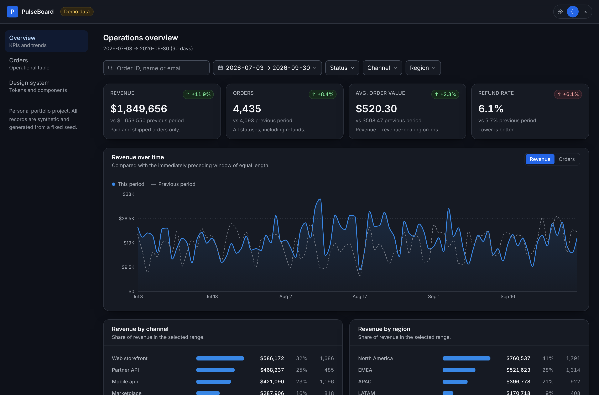
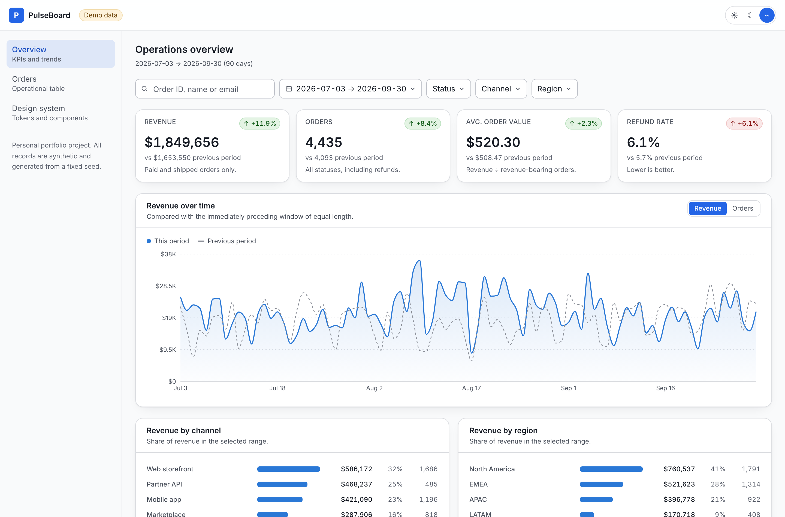
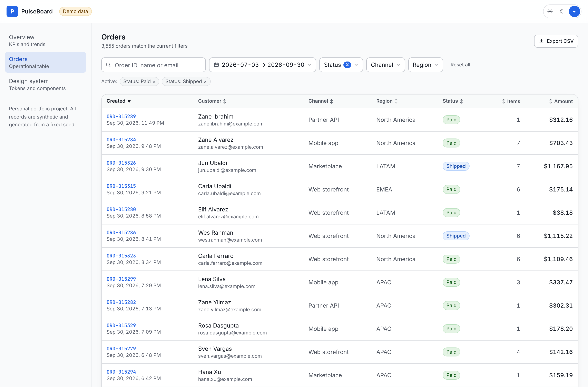
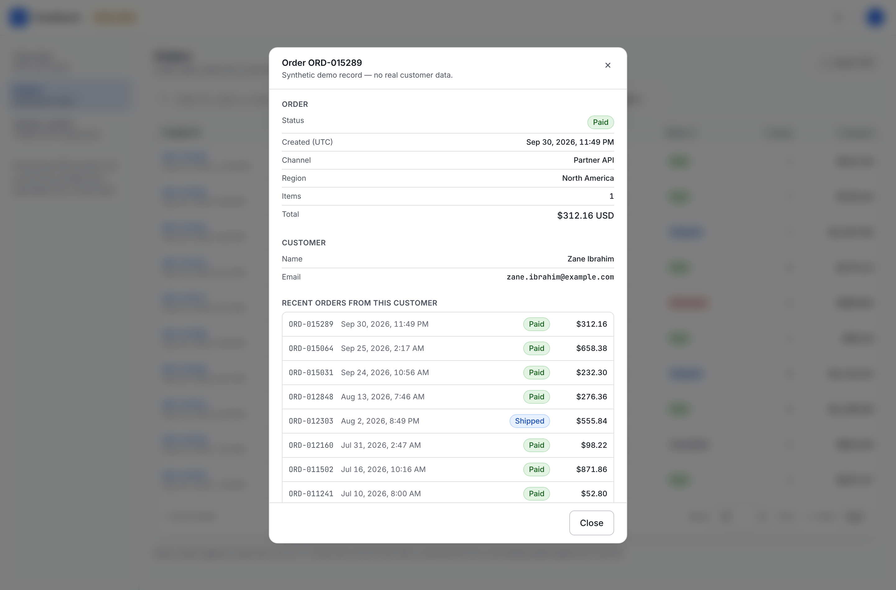
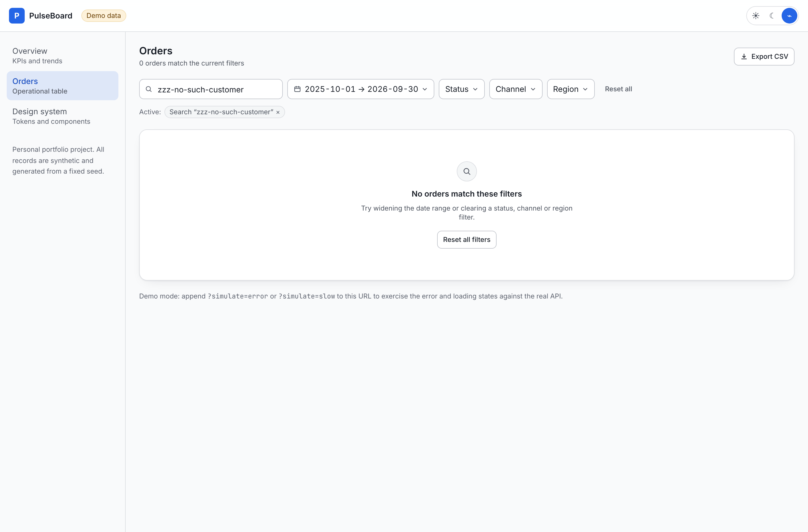
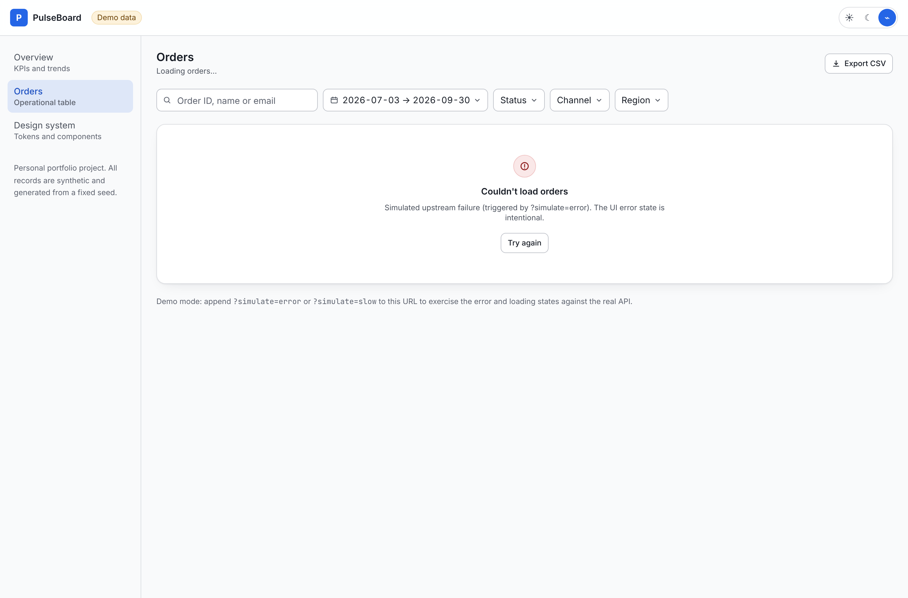
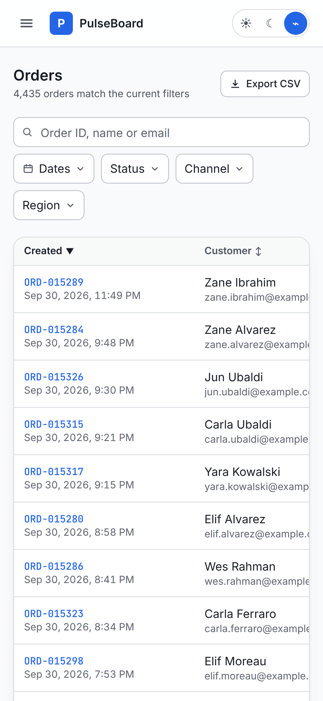

# PulseBoard — analytics & operations dashboard

A production-style analytics and operations dashboard built with Next.js 16,
React 19 and strict TypeScript. Server-side filtering, sorting and pagination
over ~15,000 records; period-over-period KPIs; an accessible data table; and
CSV reporting that always matches what is on screen.

> **Personal portfolio project.** Built by Shubham Naik in October 2026 as
> independent work — not a client deliverable and not production software for
> any employer. **Every record is synthetic**, generated in-process from a
> fixed PRNG seed. No real customer, company or employer data is present
> anywhere in this repository.

| | |
|---|---|
| **Live demo** | _not yet deployed — see [Deployment](#deployment)_ |
| **Stack** | Next.js 16 (App Router) · React 19 · TypeScript 5 (strict+) · Tailwind CSS 4 · TanStack Query 5 · Recharts 3 · Zod 4 |
| **Tests** | 83 unit / component / route-handler (Vitest) + 45 end-to-end (Playwright, 2 viewports), including 14 automated axe-core accessibility scans |
| **Quality gates** | `tsc --noEmit` · ESLint 9 flat config · Vitest · Playwright · `next build` — all green, all run in CI |



---

## The problem it solves

Internal operations dashboards fail in a small number of recurring ways. This
project is built around fixing those specifically, rather than around a feature
list:

| Common failure | What this does instead |
|---|---|
| Filter state lives in a store, so a filtered view can't be shared or bookmarked | Every filter lives in the URL; a filtered view **is** a link ([ADR 0001](docs/adr/0001-url-as-state.md)) |
| The client downloads everything and filters in the browser | Filtering, sorting and pagination run server-side; the browser only ever receives one page |
| "vs last period" is computed against the wrong window | One tested function derives the comparison window, and the same non-date filters are applied to it so it compares like with like |
| An API failure renders as `0` instead of an error | Non-2xx responses become typed `ApiError`s; the UI shows an error state with a retry, and 4xx are never retried |
| A CSV export doesn't match the filtered view | The export route runs the *same* query engine as the table |
| Charts look fine until someone opens them in dark mode or can't distinguish red from green | The palette is generated from one TypeScript source and was validated by script for colour-vision deficiency and surface contrast in both themes ([ADR 0004](docs/adr/0004-chart-colour-system.md)) |

---

## What is actually implemented

Everything in this list works in the running app and is covered by a test.

**Data & querying**

- Deterministic synthetic dataset — 15,332 orders over 365 days, generated
  from a fixed seed with weekday rhythm, growth trend and seasonal shaping, so
  the data is reproducible across server, CI and local runs.
- Server-side filter / sort / paginate over a pure, framework-free query
  engine (`lib/query/orders.ts`) whose signatures map directly onto SQL.
- Zod validation of the entire query string at the request boundary, with
  machine-readable issues returned on a 400.
- A stable total ordering (`id` as tiebreaker) so paging never drops or
  duplicates a row when sorting by a low-cardinality column.

**Metrics**

- Four KPIs — revenue, orders, average order value, refund rate — each with a
  period-over-period comparison.
- Polarity-aware trends: a falling refund rate is reported as an improvement.
- Dense daily series (days with no orders emit a zero point, so the chart
  cannot imply a gap that isn't there).
- Revenue breakdowns by channel and region, reconciled against the headline
  figure by test.

**UI**

- Responsive app shell with sidebar, mobile drawer, and a skip link as the
  first tab stop.
- Interactive trend chart with a crosshair tooltip and a measure switcher
  (never a dual axis — see [ADR 0004](docs/adr/0004-chart-colour-system.md)).
- Ranked-bar breakdowns built as real `<table>`s with direct value labels.
- Sortable, paginated data table with `aria-sort`, one focusable control per
  row, and `aria-busy` during background refetches.
- Order detail dialog built on the platform's `<dialog>` element, with a
  second independently-cached query for that customer's history.
- Multi-select facet popovers, a date-range control with presets, a debounced
  search box, and removable "active filter" chips.
- Loading skeletons, empty states and error states with retry, everywhere data
  is fetched.
- Light / dark / system theming with no flash on first paint.
- CSV export of the filtered result set, with formula-injection escaping and a
  server-side row cap.
- A `/system` page documenting every design token and component variant.

**Demo affordances (deliberate, and labelled as such)**

`?simulate=error` and `?simulate=slow` on any dashboard URL inject a server
failure or latency, so the error and loading paths can be exercised against the
real API — by a reviewer, and by the e2e suite.

---

## Screenshots

| Overview (light) | Orders table |
|---|---|
|  |  |

| Order detail | Empty state |
|---|---|
|  |  |

| Error state | Mobile |
|---|---|
|  |  |

The design system page is captured in
[`docs/screenshots/design-system.png`](docs/screenshots/design-system.png).

---

## Architecture

```
Browser                          Server (Next.js route handlers)
┌──────────────────────┐         ┌───────────────────────────────┐
│ URL query string     │────────▶│ parseOrdersQuery()  (Zod)     │
│  = single source of  │         │   └─ invalid → 400 + issues   │
│    truth (ADR 0001)  │         ├───────────────────────────────┤
├──────────────────────┤         │ queryOrders()   filter/sort/  │
│ useDashboardState()  │         │ computeMetrics()  paginate    │
│  parse · canonicalise│         │   (pure, no framework)        │
├──────────────────────┤         ├───────────────────────────────┤
│ TanStack Query       │◀────────│ getDataset()  seeded, cached  │
│  key = query string  │  JSON   │   (swap for a DB repository)  │
├──────────────────────┤         └───────────────────────────────┘
│ Presentational React │
│  components/ui · charts
└──────────────────────┘
```

The deliberate separation is **presentation / business logic / data access**:

- `src/lib/query/*` — pure functions. No React, no `fetch`, no Next.js. This is
  where the filtering rules, the comparison-window arithmetic and the KPI
  definitions live, which is why they are cheap to unit-test exhaustively.
- `src/app/api/*` — thin route handlers: validate, call the engine, serialise.
- `src/components/*` — presentational. The only components that know about the
  network are the three view containers.
- `src/lib/data/*` — the data source. Replacing the in-memory generator with a
  database repository means changing one module; nothing above it moves.

### Project structure

```
src/
├── app/
│   ├── api/
│   │   ├── meta/route.ts            facet vocabulary + dataset provenance
│   │   ├── metrics/route.ts         KPIs, series, breakdowns
│   │   └── orders/
│   │       ├── route.ts             paginated orders
│   │       └── export/route.ts      CSV of the filtered set
│   ├── orders/page.tsx              table route
│   ├── system/page.tsx              design-system reference
│   ├── page.tsx                     overview route
│   ├── error.tsx  not-found.tsx     route-level boundaries
│   ├── layout.tsx  providers.tsx    shell, fonts, query client
│   └── globals.css                  design tokens (the only colour source)
├── components/
│   ├── ui/                          Button, Card, Badge, Field, Modal, Popover, states
│   ├── charts/                      TrendChart, RankedBars
│   ├── dashboard/                   KpiCard, FilterBar, OrdersTable, Pagination, …
│   ├── app-shell.tsx  theme-*.tsx
├── hooks/                           useDashboardState, useVizColors
├── lib/
│   ├── api/                         typed fetch client, response helpers
│   ├── data/                        seeded PRNG, catalog, dataset generator
│   ├── query/                       schema (Zod), orders engine, metrics, defaults
│   ├── csv.ts  format.ts  cn.ts  viz-palette.ts
└── types/domain.ts                  the shared domain contract
tests/
├── unit/          query schema, orders engine, metrics, CSV
├── components/    React Testing Library
├── integration/   route handlers invoked directly as (Request) => Response
└── e2e/           Playwright: journeys + axe-core accessibility
docs/adr/          architecture decision records
```

### Architecture decisions

Each of these is written up with its trade-offs and the conditions under which
I'd revisit it:

- [ADR 0001 — The URL is the single source of truth](docs/adr/0001-url-as-state.md)
- [ADR 0002 — `cacheComponents` is deliberately off](docs/adr/0002-no-cache-components.md)
- [ADR 0003 — Dependency budget](docs/adr/0003-dependency-budget.md)
- [ADR 0004 — Chart colour is computed and validated](docs/adr/0004-chart-colour-system.md)
- [ADR 0005 — Fonts are self-hosted from npm](docs/adr/0005-self-hosted-fonts.md)

---

## Getting started

Requires **Node.js 22.12+** (Vitest 5 requires it; Next.js 16 requires 20.9+).

```bash
git clone <repository-url>
cd pulseboard-analytics
npm ci
npm run dev          # http://localhost:3000
```

No environment variables are needed — the dataset is generated in-process.
Copy `.env.example` to `.env.local` if you want to set the optional ones.

### Scripts

| Command | What it does |
|---|---|
| `npm run dev` | Dev server (Turbopack) |
| `npm run build` | Production build |
| `npm start` | Serve the production build |
| `npm run typecheck` | `next typegen` + `tsc --noEmit` |
| `npm run lint` | ESLint 9 flat config |
| `npm run test` | Vitest: unit, component and route-handler tests |
| `npm run test:watch` | Vitest in watch mode |
| `npm run test:e2e` | Playwright (builds and serves automatically) |
| `npm run test:e2e:install` | One-time Playwright browser download |
| `npm run verify` | typecheck → lint → test → build, in order |

---

## Testing

### What is covered

| Layer | Tool | Files | What it proves |
|---|---|---|---|
| Query validation | Vitest | `tests/unit/query-schema.test.ts` | Defaults, coercion, facet de-duplication, rejection of junk, impossible calendar dates, reversed-range swap, default-window redirect |
| Query engine | Vitest | `tests/unit/orders-query.test.ts` | Dataset determinism, inclusive ranges, AND-across-facets / OR-within-facet, stable total ordering, page clamping, non-overlapping pages, comparison-window arithmetic |
| Metrics | Vitest | `tests/unit/metrics.test.ts` | Revenue recognition rules, no `NaN`/`Infinity` on empty sets, polarity inversion for refund rate, dense series, breakdowns reconciling to the headline figure |
| CSV | Vitest | `tests/unit/csv.test.ts` | Quoting, embedded quotes/commas/newlines, **spreadsheet formula-injection neutralisation** |
| Components | RTL | `tests/components/*` | `aria-sort` announcement, keyboard operation, label mapping, trend polarity not conveyed by colour alone, pagination bounds |
| Route handlers | Vitest | `tests/integration/api-routes.test.ts` | Real `Request` → real `Response`: status codes, headers, 400 issue payloads, CSV `content-disposition`, filtered export row counts |
| Journeys | Playwright | `tests/e2e/dashboard.spec.ts` | Filtering, sorting, searching, pagination, dialog + Escape, CSV download, error state, invalid-URL reporting, theme persistence, mobile drawer, no horizontal overflow |
| Accessibility | Playwright + axe-core | `tests/e2e/accessibility.spec.ts` | WCAG 2.1 A/AA scan of all three routes in **both themes**, plus the table with filters applied and a dialog open |

### Verified results

Last run on this codebase, Node 22.22.0, Linux:

```
$ npm run typecheck
  (clean — no output)

$ npm run lint
  (clean — 0 errors, 0 warnings)

$ npm run test
  Test Files  8 passed (8)
       Tests  83 passed (83)

$ npm run test:e2e
  45 passed, 1 skipped (1.2m)
  projects: chromium-desktop (1440×900), chromium-mobile (Pixel 7)

$ npm run build
  ✓ Compiled successfully
  ✓ Generating static pages (10/10)
  Routes: / (ƒ)  /orders (ƒ)  /system (○)  /_not-found (○)
          /api/meta /api/metrics /api/orders /api/orders/export (ƒ)
```

Three real defects were found by these tests during development and fixed:

1. `Date.parse("2026-02-31")` does not fail — JavaScript rolls the overflow
   forward to 3 March — so impossible calendar dates were being accepted. The
   validator now round-trips the date back to a day key and compares.
2. `?simulate=error` never reached the API, because the client rebuilds a
   canonical query string and was dropping unrecognised parameters. The flag is
   now part of the validated schema.
3. The axe-core pass rejected **nine** colour-contrast failures, including
   amber "Pending" chip text at 1.66:1. Status chips were rebuilt as explicit
   background/foreground/border triplets, all verified at ≥ 4.5:1 in both
   themes.

### Running them yourself

```bash
npm run test                    # unit + component + route handlers
npm run test:e2e:install        # once, downloads Chromium
npm run test:e2e                # builds, serves on :3100, runs both projects
npm run test:e2e -- --ui        # interactive
```

On a sandboxed runner without browser downloads, point Playwright at an
existing Chromium: `PLAYWRIGHT_CHROMIUM_PATH=/path/to/chrome npm run test:e2e`.

---

## Accessibility

Not an afterthought, and not claimed without evidence:

- Automated WCAG 2.1 A/AA scans (axe-core) over every route in both themes,
  including the table-with-dialog state — currently **zero violations**.
- A skip link as the first tab stop; one `<h1>` and one labelled `<main>` per
  page.
- Sortable headers are `<button>`s inside `<th scope="col">` with `aria-sort`.
- The modal is the platform `<dialog>` with `showModal()`, so focus trapping,
  background inertness and `Escape` are the browser's correct implementation
  rather than a hand-rolled one.
- Popover triggers extend their accessible name with visually-hidden text
  rather than an `aria-label`, so the visible text remains part of the name
  (WCAG 2.5.3, Label in Name — an `aria-label` that omits the visible label
  breaks voice control).
- Scrollable regions are keyboard-focusable.
- Status and trend are always glyph + label + colour, never colour alone.
- One centralised, visible focus ring; `prefers-reduced-motion` respected.
- All formatters pin locale and time zone, so server and client markup agree.

---

## Performance notes

Optimisations here are responses to specific costs, not reflexive memoisation:

- The client never downloads the dataset — pagination happens server-side.
- The dataset is generated once per process and cached by option set.
- `placeholderData` keeps the previous page on screen during a refetch, so
  paging and filtering don't flash skeletons.
- The search input is debounced (300 ms) so typing doesn't push a URL and fire
  a request per keystroke.
- Retries are policy-driven: 4xx are never retried, 5xx back off exponentially.
- Requests are cancelled via the `AbortSignal` TanStack Query provides.
- Fonts are self-hosted and variable: one file per family, no third-party
  connection on the critical path.
- The x-axis emits ~6 ticks regardless of window length, so a 365-day range
  doesn't degrade into an unreadable smear.

---

## Deployment

**Not currently deployed.** This repository has no hosting credentials
configured, and no deployment has been performed or verified — so no live URL
is claimed.

The app is a standard Next.js 16 application with no database, no external
service and no required environment variables, so deploying it is:

```bash
# Vercel
npx vercel --prod

# or any Node host
npm ci && npm run build && npm start
```

Set `NEXT_PUBLIC_REPO_URL` if you want the header "Source" link. When a demo is
live, this section and the table at the top will be updated with the real URL.

---

## Known limitations

Stated plainly, because a portfolio project that pretends to be complete is
less convincing than one that knows what it isn't:

1. **The data is synthetic and read-only.** There is no database and no write
   path. The data layer is isolated behind `lib/data/` precisely so a real
   repository could replace it, but that work has not been done here.
2. **No authentication or authorisation.** Everything is public by design —
   this is a demo of the data-presentation layer. Role-based access is the
   subject of a separate project.
3. **The dataset window is fixed** (2025-10-01 → 2026-09-30). Date presets are
   resolved against the dataset's last day rather than the wall clock, which is
   correct for a fixed demo window but is not what a live system would do.
4. **No visual-regression testing.** Screenshots are captured manually.
5. **Chart accessibility stops at the table fallback.** The breakdowns are real
   tables, but the trend chart itself has no sonification or keyboard
   data-point navigation.
6. **`npm audit` reports 5 high-severity advisories**, all from one transitive
   dev-only chain (`eslint-config-next` → `@next/eslint-plugin-next` →
   `fast-glob` → `micromatch` → `braces`). The only available "fix" is a
   downgrade of `eslint-config-next` to v14, which would be a larger regression
   than the risk it removes. No runtime dependency is affected.
7. **E2E runs on Chromium only.** Firefox and WebKit projects are a config
   change away but have not been executed.

---

## Attribution

- All application code in this repository is original work written for this
  project.
- Open-source dependencies are listed in `package.json` and retain their own
  licences in `node_modules`; none are vendored or re-licensed here.
- Fonts: [Inter](https://rsms.me/inter/) and
  [JetBrains Mono](https://www.jetbrains.com/lp/mono/), both SIL Open Font
  License 1.1, installed via [Fontsource](https://fontsource.org/).
- The categorical chart palette and the contrast/colour-vision validation
  methodology follow a published data-visualisation guideline; the specific
  hues were re-validated against this project's own surfaces and the output is
  recorded in [ADR 0004](docs/adr/0004-chart-colour-system.md).
- No starter template, paid theme or third-party project source was copied.

## Licence

[MIT](LICENSE) © 2026 Shubham Naik
